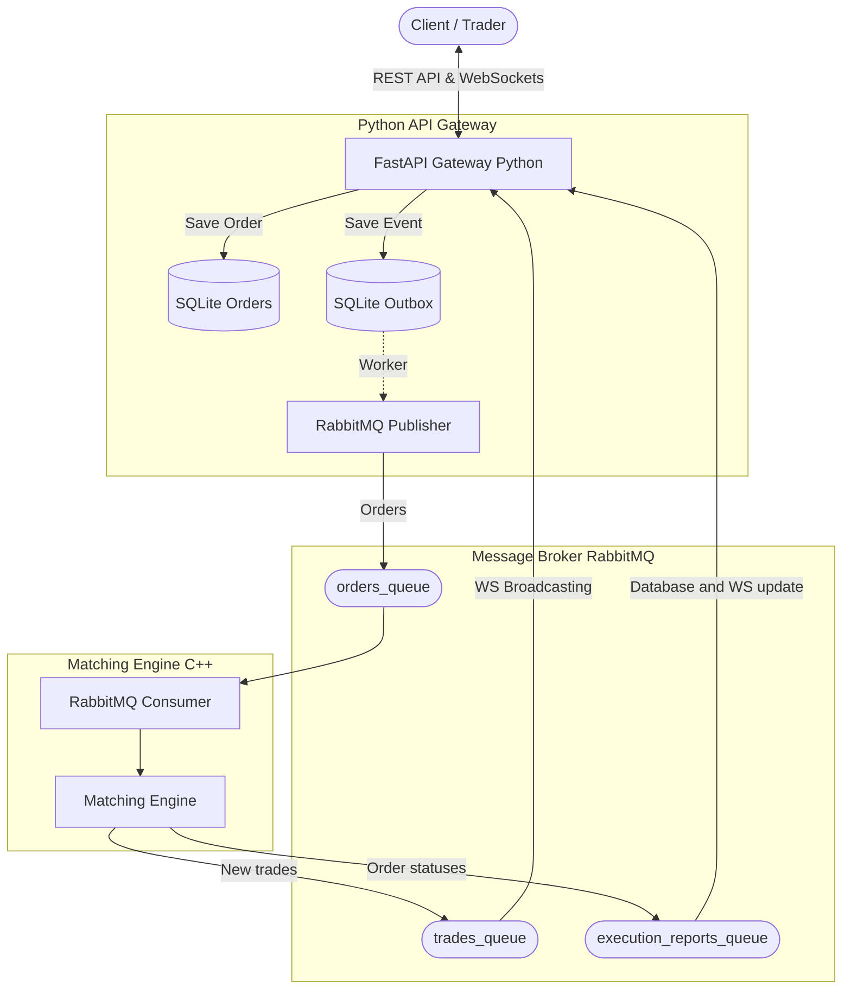

# Microservices Trading & Matching Engine 🚀

A high-performance, distributed exchange system consisting of an asynchronous API gateway (Python) and an ultra-fast order matching engine (C++). The services communicate asynchronously using RabbitMQ in an Event-Driven architecture.

The project implements advanced design patterns, such as the **Transactional Outbox**, solving the problem of distributed data consistency between a relational database and a message broker.

## 🏗 Architecture Diagram



## ✨ Key Features

- **Matching Engine (C++):** Supports `LIMIT` and `MARKET` orders. Business logic is based on `std::map` structures for lightning-fast retrieval of the best offers and handling of partial fills.
- **Asynchronous API (Python):** Built with FastAPI, accepting REST orders (`POST`, `PUT`, `DELETE`). It manages WebSocket connections using a dedicated `ConnectionManager` to broadcast real-time market data.
- **Transactional Outbox Pattern:** Guarantees reliable message delivery. Orders are first saved to an SQLite database, and an asynchronous worker safely publishes them to RabbitMQ.
- **Event-Driven Architecture:** Complete decoupling of the API from the engine logic through asynchronous RabbitMQ queues. Utilizes the `rabbitmq-c` client in C++ and the `aio_pika` library in Python.

## 🛠 Technologies Used

**Backend & API:**
- **Python 3.10+**
- **FastAPI** – Asynchronous web framework for handling REST API and WebSockets.
- **SQLAlchemy (Async)** – ORM for managing order states and the Outbox model.
- **Pydantic** – Data structure and request schema validation.
- **aiosqlite** – Asynchronous SQLite database driver.

**Matching Engine:**
- **C++ (C++17)** – Business logic and memory operations.
- **rabbitmq-c** – Optimized RabbitMQ client for C.
- **nlohmann/json** – Library for JSON message serialization and deserialization.

**Infrastructure & QA:**
- **RabbitMQ** – Reliable message broker (*durable* queues).
- **Pytest & pytest-asyncio** – Unit tests for the asynchronous API (with WebSocket and RabbitMQ mocking).
- **Google Test (GTest)** – Testing framework for C++ business logic.

---

## 📂 Project Structure

```text
.
├── src/
│   ├── python/
│   │   ├── main.py              # FastAPI application (Endpoints, WebSockets, Outbox)
│   │   └── rabbitmq.py          # Asynchronous RabbitMQ configuration
│   └── cpp/
│       ├── main.cpp             # C++ entry point (Engine and RabbitMQ initialization)
│       ├── MatchingEngine.cpp   # Routing orders to appropriate instruments
│       ├── OrderBook.cpp        # Matching logic (bids/asks)
│       ├── RabbitMQConsumer.cpp # Listening for orders
│       ├── RabbitMQPublisher.cpp# Publishing results
│       └── Utils.cpp            # Loading .env
├── include/                     # C++ header files
│   ├── MatchingEngine.hpp
│   ├── OrderBook.hpp
│   ├── models.hpp               # C++ data models
│   ├── RabbitMQCommon.hpp
│   ├── RabbitMQConsumer.hpp
│   └── RabbitMQPublisher.hpp
└── tests/
    ├── python/                  # FastAPI and Outbox pattern tests (pytest)
    └── cpp/                     # Engine tests (GTest)
```

---

## 🚀 Local Run (without Docker)

To run the project natively, you must have installed on your system: Python 3.10+, a C++ compiler (with C++17 support), the `rabbitmq-c` and `nlohmann-json` libraries, and a locally running RabbitMQ server.

### 1. System Requirements (example for Ubuntu/Debian)
```bash
sudo apt update
sudo apt install rabbitmq-server g++ make librabbitmq-dev nlohmann-json3-dev python3-pip python3-venv
```
Ensure the RabbitMQ service is running:
```bash
sudo systemctl start rabbitmq-server
```

### 2. API Setup and Execution (Python)
In the first terminal, configure the virtual environment and start the backend:
```bash
# Create and activate virtual environment
python3 -m venv venv
source venv/bin/activate

# Install dependencies
pip install fastapi uvicorn sqlalchemy aiosqlite aio-pika pydantic

# Set environment variable and start the server
export PYTHONPATH=$(pwd)
uvicorn src.python.main:app --host 0.0.0.0 --port 8000 --reload
```
The application and Swagger UI documentation will be available at: `http://localhost:8000/docs`

### 3. Engine Compilation and Execution (C++)
In the second terminal, compile the engine code and link it with the RabbitMQ library:
```bash
# Compile the engine
g++ -std=c++17 \
    src/cpp/main.cpp \
    src/cpp/MatchingEngine.cpp \
    src/cpp/OrderBook.cpp \
    src/cpp/RabbitMQConsumer.cpp \
    src/cpp/RabbitMQPublisher.cpp \
    src/cpp/Utils.cpp \
    -I./include -lrabbitmq -o matching_engine

# Run the compiled program
./matching_engine
```
