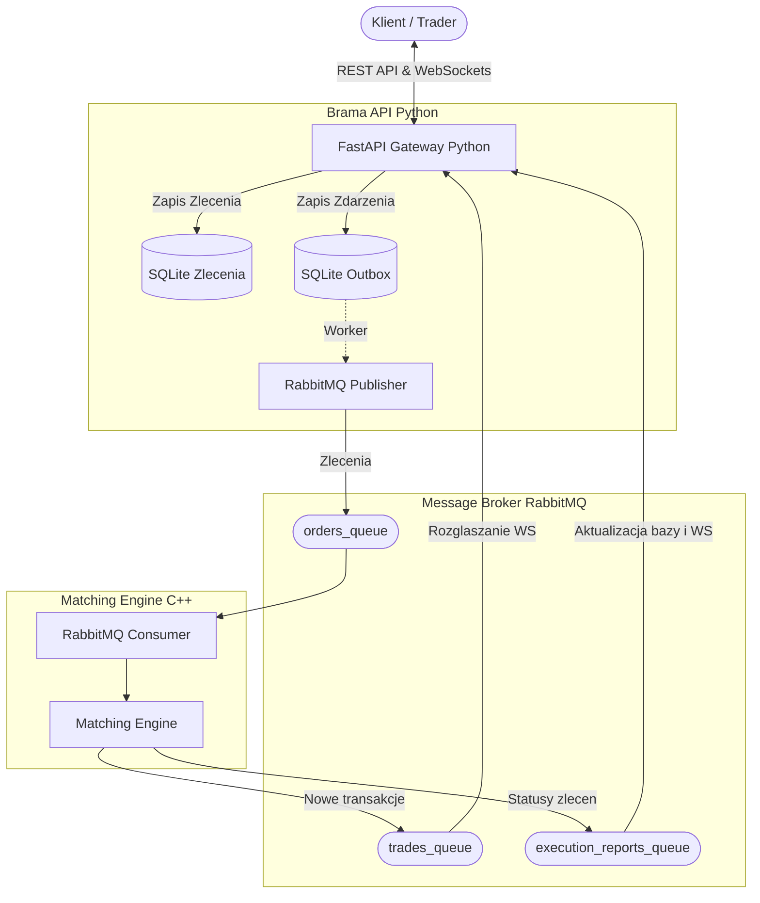

# Microservices Trading & Matching Engine 🚀

Wydajny, rozproszony system giełdowy składający się z asynchronicznej bramy API (Python) oraz ultraszybkiego silnika dopasowującego zlecenia (C++). Serwisy komunikują się ze sobą asynchronicznie za pomocą RabbitMQ w architekturze sterowanej zdarzeniami (Event-Driven). 

Projekt wdraża zaawansowane wzorce projektowe, takie jak **Transactional Outbox**, rozwiązując problem rozproszonej spójności danych pomiędzy relacyjną bazą danych a brokerem wiadomości.

## 🏗 Schemat Architektury



## ✨ Główne funkcjonalności

* **Silnik Dopasowujący (C++):** Obsługa zleceń typu `LIMIT` i `MARKET`. Logika biznesowa oparta na strukturach `std::map` do błyskawicznego odnajdywania najlepszych ofert i obsługi częściowych realizacji zleceń (partial fills).
* **Asynchroniczne API (Python):** Zbudowane w FastAPI, przyjmujące zlecenia REST (`POST`, `PUT`, `DELETE`). Zarządza połączeniami WebSocket za pomocą dedykowanego `ConnectionManager` do rozgłaszania danych rynkowych w czasie rzeczywistym.
* **Transactional Outbox Pattern:** Gwarancja niezawodnego dostarczenia komunikatów. Zlecenia najpierw trafiają do bazy danych SQLite, a asynchroniczny worker bezpiecznie wysyła je do RabbitMQ.
* **Architektura Event-Driven:** Pełne odseparowanie API od logiki silnika poprzez asynchroniczne kolejki RabbitMQ. Użycie klienta `rabbitmq-c` w C++ oraz biblioteki `aio_pika` w Pythonie.

## 🛠 Użyte Technologie

**Backend & API:**
* **Python 3.10+**
* **FastAPI** – Asynchroniczny framework webowy do obsługi REST API i WebSockets.
* **SQLAlchemy (Async)** – ORM do zarządzania stanem zleceń i modelem Outbox.
* **Pydantic** – Walidacja struktur danych i schematów żądań.
* **aiosqlite** – Asynchroniczny sterownik bazy danych SQLite.

**Silnik Dopasowujący (Matching Engine):**
* **C++ (C++17)** – Logika biznesowa i operacje na pamięci.
* **rabbitmq-c** – Zoptymalizowany klient RabbitMQ dla języka C.
* **nlohmann/json** – Biblioteka do serializacji i deserializacji wiadomości JSON.

**Infrastruktura & QA:**
* **RabbitMQ** – Niezawodny broker wiadomości (kolejki *durable*).
* **Pytest & pytest-asyncio** – Testy jednostkowe asynchronicznego API (z mockowaniem WebSockets i RabbitMQ).
* **Google Test (GTest)** – Framework do testowania logiki biznesowej C++.

---

## 📂 Struktura Projektu

```text
.
├── src/
│   ├── python/
│   │   ├── main.py              # Aplikacja FastAPI (Endpoints, WebSockets, Outbox)
│   │   └── rabbitmq.py          # Konfiguracja asynchronicznego RabbitMQ
│   └── cpp/
│       ├── main.cpp             # Punkt wejścia dla C++ (Inicjalizacja silnika i RabbitMQ)
│       ├── MatchingEngine.cpp   # Routing zleceń do odpowiednich instrumentów
│       ├── OrderBook.cpp        # Logika dopasowywania (bids/asks)
│       ├── RabbitMQConsumer.cpp # Nasłuchiwanie zleceń
│       ├── RabbitMQPublisher.cpp# Publikacja wyników
│       └── Utils.cpp            # Ładowanie .env
├── include/                     # Pliki nagłówkowe C++
│   ├── MatchingEngine.hpp
│   ├── OrderBook.hpp
│   ├── models.hpp               # Modele danych C++
│   ├── RabbitMQCommon.hpp
│   ├── RabbitMQConsumer.hpp
│   └── RabbitMQPublisher.hpp
└── tests/
    ├── python/                  # Testy FastAPI i wzorca Outbox (pytest)
    └── cpp/                     # Testy silnika (GTest)
```

---

## 🚀 Uruchomienie lokalne (bez Dockera)

Aby uruchomić projekt natywnie, musisz mieć zainstalowane w systemie: Pythona 3.10+, kompilator C++ (z obsługą C++17), biblioteki `rabbitmq-c` i `nlohmann-json` oraz działający lokalnie serwer RabbitMQ.

### 1. Wymagania systemowe (przykład dla Ubuntu/Debian)
```bash
sudo apt update
sudo apt install rabbitmq-server g++ make librabbitmq-dev nlohmann-json3-dev python3-pip python3-venv
```
Upewnij się, że usługa RabbitMQ działa:
```bash
sudo systemctl start rabbitmq-server
```

### 2. Konfiguracja i uruchomienie API (Python)
W terminalu pierwszym skonfiguruj środowisko wirtualne i uruchom backend:
```bash
# Utworzenie i aktywacja środowiska wirtualnego
python3 -m venv venv
source venv/bin/activate

# Instalacja zależności
pip install fastapi uvicorn sqlalchemy aiosqlite aio-pika pydantic

# Ustawienie zmiennej środowiskowej i uruchomienie serwera
export PYTHONPATH=$(pwd)
uvicorn src.python.main:app --host 0.0.0.0 --port 8000 --reload
```
Aplikacja oraz dokumentacja Swagger UI będą dostępne pod adresem: `http://localhost:8000/docs`

### 3. Kompilacja i uruchomienie Silnika (C++)
W terminalu drugim skompiluj kod silnika i połącz go z biblioteką RabbitMQ:
```bash
# Kompilacja silnika
g++ -std=c++17 \
    src/cpp/main.cpp \
    src/cpp/MatchingEngine.cpp \
    src/cpp/OrderBook.cpp \
    src/cpp/RabbitMQConsumer.cpp \
    src/cpp/RabbitMQPublisher.cpp \
    src/cpp/Utils.cpp \
    -I./include -lrabbitmq -o matching_engine

# Uruchomienie skompilowanego programu
./matching_engine
```
